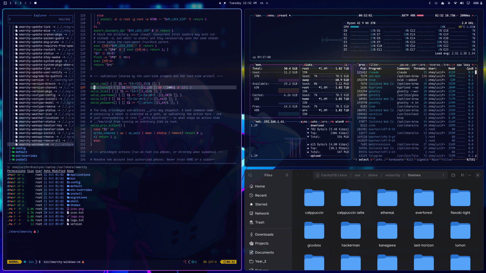

# Edgerunners

A theme for [Omarchy](https://omarchy.org), after *Cyberpunk: Edgerunners*.

```
Edgerunners — a dark theme drawn from Cyberpunk: Edgerunners: Night City
after rain, neon signs bleeding through a wet window, Lucy's pale hair lit
cyan on one side and magenta on the other, the hot pink-red of the show's
key art, and a rocket climbing toward the moon on a line of yellow fire.

Surfaces are the midnight indigo of the night skies, sampled at #0C0C21
and #020D32, kept violet-blue rather than neutral. Text is the lavender
white of Lucy's hair highlights. The two neons split the work: Lucy cyan
for selection and focus, the pink-red for the accent, alerts and errors.

Hues sampled from the wallpapers: key-art pink-red #F90251 (red), HOTEL
sign neon #F48A6E (orange), rocket flare #C0CB3A and Cyberpunk's own
#F3E600 (yellow, bright yellow), Lucy cyan #34C2E5 (cyan), Lucy blue
#5C9BFA (blue), neon violet #BF59D0 / #EF88DF (magenta), bottle glass and
street wood #886A3E (brown), rain haze #57649D (muted). The scenes have no
green, so green is an acid green set well away from the cyan.

Lightness is solved in OKLCH against `lighter_background`, the lightest
surface any colour lands on, taking the darkest value that clears the
target so colours stay rich. Every ANSI colour clears 6.0:1 (brown, kept
dim on purpose, 4.6:1; yellow 7.5:1, since a darker yellow turns olive),
bright variants clear 9.5:1, and foregrounds run 7.1:1 to 15.9:1. No two
different hues are closer than 15.4 CIEDE2000, and each bright sits 11+
from its normal, so nothing blends into a neighbour.
```



## Install

Clone the repo and symlink it into Omarchy's themes:

```bash
git clone https://github.com/Sothcheat/omarchy-edgerunners-theme ~/.local/share/omarchy-themes/edgerunners
ln -s ~/.local/share/omarchy-themes/edgerunners ~/.config/omarchy/themes/edgerunners
omarchy theme set Edgerunners
```

`omarchy theme install` works too, but Omarchy drops a cloned theme's Lua files, so you would lose `hyprland.lua` (border, see-through terminals) and `neovim.lua` (the tuned syntax). A symlinked theme counts as your own copy and keeps them. Update with `git pull` in the clone.

## Contents

Omarchy generates every app's theme from `colors.toml`; the theme ships its own version of these:

- `hyprland.lua`: the cyan-to-violet neon window border and slightly see-through terminals.
- `shell.toml`: bar, menus, notifications and lock screen. The pink-red is kept for errors and alerts; selections use Lucy cyan.
- `neovim.lua`: aether with the shared editor syntax (below).
- `btop.theme`: graphs run from Lucy cyan to the key-art pink-red; each panel outline has its own dimmed colour.
- `icons.theme`: Yaru-blue-dark, after Lucy's hair.
- `unlock.png`: Lucy's moon over Night City, a glitched neon crescent with the rocket climbing toward it, for the login and boot screens. Apply it with `omarchy-plymouth-set-by-theme edgerunners`. `art/build.py` draws it, along with `preview-unlock.png` and the fastfetch logo.
- `bar-logo.png`: a small neon crescent for the bar's menu button. Omarchy's own button doesn't read it; it's for a bar widget that shows the current theme's `bar-logo.png` (such as a cloned `omarchy.menu` button that loads `~/.local/state/omarchy/current/theme/bar-logo.png`), and other setups simply ignore it.
- `preview.png`, `preview-unlock.png`: the theme picker images.
- `backgrounds/`: fan art and stills of Lucy: the rocket launch, a rainy window over Night City, the red key-art portrait, and Lucy at a window under the full moon as the rocket climbs ([Wallhaven jxg7x5](https://wallhaven.cc/w/jxg7x5)). The bar is often transparent, so each carries a soft dark band at the top that keeps bar text above 4.9:1. Cycle them with `omarchy theme bg next`. The wallpapers are other people's work, collected from wallpaper sites; their artists are unknown to me, and they stay theirs.

### Editors

`editors/build.py` builds matching VS Code and Zed themes from `colors.toml`; Neovim uses the same mapping. Syntax follows One Monokai's structure, where every role has its own hue:

| Role | Colour |
| --- | --- |
| Keywords, operators, tags | neon pink-red |
| Declaration words (`function`, `class`, `const`), constants, built-in types | Lucy cyan |
| Functions, attributes | acid green |
| Classes, types, modules | Lucy blue |
| Strings | rocket gold |
| Numbers, template `${}` | neon violet |
| Parameters | HOTEL orange, italic |
| `this` / `self` | neon pink-red, italic |
| Comments | rain haze, italic |

- **VS Code:** `editors/vscode/` is a ready extension. Zip it as a `.vsix` (see the files inside) or copy the folder to `~/.vscode/extensions/ohmylucifer.edgerunners-theme-1.0.0`, then pick "Edgerunners" with Ctrl+K Ctrl+T.
- **Zed:** copy `editors/zed/edgerunners.json` to `~/.config/zed/themes/` and pick "Edgerunners" in the theme selector.
- **Telegram Desktop:** `editors/telegram/edgerunners.tdesktop-theme` is Telegram's night theme recoloured by role, with the rocket launch as chat background (`editors/telegram.py` rebuilds it). Send the file to Saved Messages, tap it, and choose Apply.

### Extras that need a hook

Omarchy doesn't theme these apps, so the theme ships a file for each and `hooks/` has a `theme-set` hook that puts it in place on every theme change (themes without the file get the app's default back):

| File | Hook | One-time setup |
| --- | --- | --- |
| `lazygit.yml` | `hooks/lazygit` | `export LG_CONFIG_FILE="$HOME/.config/lazygit/config.yml,$HOME/.config/lazygit/theme.yml"` in `~/.config/uwsm/env` and `~/.bashrc` |
| `zen.css` (Zen Browser) | `hooks/zen-theme` | none; the hook enables `userChrome.css` itself. Restart Zen after a theme change. |
| `fastfetch-logo.txt` (the same scene as pixel art, in 24-bit colour) | `hooks/fastfetch-logo` | point `logo.source` in `~/.config/fastfetch/config.jsonc` at `~/.config/fastfetch/logo.txt` (type `file`); needs a true-colour terminal |
| `gtk-accent.theme` (teal accent for Nautilus and GTK4 apps) | `hooks/gtk-accent` | none |

Install a hook with `omarchy hook install theme-set hooks/<name>`, then re-apply the theme.
